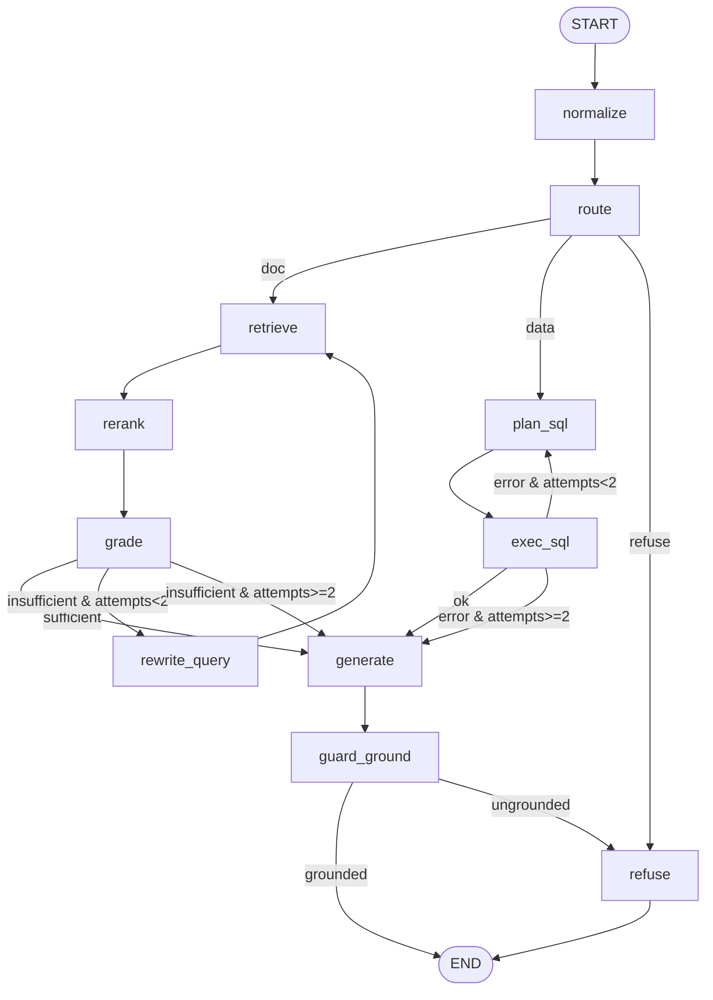

# Bilingual (FA/EN) RAG + Text-to-SQL Assistant — Technical Plan

**Status:** Draft for review. No implementation code. Plan mode.
**Author:** Tech lead (Claude). **Date:** 2026-07-26.
**Numeric-verification pass (COMPLETE, 2026-07-26):** three web-research subagents re-confirmed every §2 fact against live docs (Gemini 3.6 Flash post-dates the model knowledge cutoff, so nothing here is asserted from memory). Deltas folded in below.

### Verification results — corrections to the brief's §2 (2026-07-26)

| Brief claim | Verdict | Corrected fact |
|---|---|---|
| Gemini 3.6 Flash is a **preview** model | **CHANGED** | It is labeled **GA/Stable**, not preview. Deprecation risk is lower; keep the fallback chain as good practice, not necessity. ([Google models doc]) |
| `temperature`/`top_p`/`seed` are **ignored/no-op** | **WRONG** | They are **honored but discouraged** — Google recommends leaving `temperature=1.0`; lowering it causes looping/degradation. The determinism strategy stands (structured output + `minimal` thinking) but its *justification* is "don't fight the sampler," not "the sampler is a no-op." Thinking levels confirmed exactly (`thinking_level`: minimal/low/medium/high). |
| Pricing $1.50/$7.50, cache-read $0.15/M | **CONFIRMED** | Plus a **$1.00/M-per-hour cache storage fee** (new detail for §13). |
| pgvector floor **0.8.2** | **CONFIRMED + updated** | CVE-2026-3172 confirmed (buffer overflow, parallel HNSW build, 0.6.0–0.8.1). 0.8.2 is the *fix* but **latest is 0.8.5** (2026-07-08). Pin `pgvector/pgvector:0.8.5-pg16`. |
| LangGraph **1.2.0** | **CHANGED** | Latest is **1.2.9** (2026-07-10). Pin exactly. Package split + `AsyncPostgresSaver` + imports all confirmed. |
| Dimension ceilings (16000/2000/4000), HNSW defaults, `iterative_scan` | **CONFIRMED** | As stated. |
| OpenRouter `/embeddings` accepts `input_type` + `dimensions` | **UNVERIFIED — OpenRouter's own docs do not document these params.** | Load-bearing for MRL truncation + query/passage asymmetry (§7). Resolve by a direct API probe before committing to Gemini Emb 2 through the gateway; may force native Google/Qwen embedding API, or accepting full native dims. |
| FaMTEB retrieval-subset numbers (e5 42.98, GTE 41.22, Tooka 27.86, BGE-M3 43.38, Jina 43.51) | **UNVERIFIED — table parsing unreliable.** | Paper/tasks/Hakim/STS-76.41 confirmed; the *retrieval column* figures need a human eyeball on Table 2 / the HF FaMTEB leaderboard. The argument's *direction* holds; the exact numbers don't yet. |
| Model/context/MRL for candidates | **CONFIRMED** | Qwen3-Embedding-8B: MTEB-multilingual **70.58**, 4096 dims, MRL 32–4096, `qwen/qwen3-embedding-8b`, **~$0.01/M** on OpenRouter. Gemini Emb 2: $0.20/M, 8192 in, MRL 128–3072, MTEB 69.9. gemini-embedding-001: $0.15/M, **2048** input. BGE-M3: dense+sparse+ColBERT one pass, 8192 in. |

[Google models doc]: https://ai.google.dev/gemini-api/docs/models

---

## 0. What changed after reading the actual code (§3 investigation)

The brief is written for a document-RAG system. **The repo is not one.** Verified findings:

| Area | Reality in the repo | Effect on the brief |
|---|---|---|
| Backend | FastAPI + SQLAlchemy 2 + psycopg3, Redis cache. All read endpoints share a Jalali-aware `Filters` object. `app/routers/*.py`. | Bot ships as one FastAPI router; reuse `Filters`, `cache.cached`, `db.get_db`. |
| DB | **PostgreSQL 16**, stock `postgres:16` image. **pgvector NOT installed.** Star schema: `fact_transaction` (SALE/RECEIVABLE/PAYABLE) + ~13 dims. `schema.sql`. | Swap image → `pgvector/pgvector:0.8.2-pg16`; add `CREATE EXTENSION vector`. |
| Corpus | **Zero documents exist today.** Only structured facts + repo markdown. | Doc-retrieval half of the system is greenfield; you (user) confirmed docs are coming → design the corpus ingestion, but Phase 1 is data-only (§11). |
| Jalali | **Already solved.** `app/jalali.py` + `jdatetime`, `dim_date` carries Jalali+Gregorian+quarter+FA month name; `Filters` speaks Jalali `YYYYMM`. | §5.3 date layer is *reused*, not rebuilt. Big scope saving. |
| Metric semantics | `dashboard.py`: `revenue = SUM(amount) FILTER (type='RECEIVABLE')`, `cost = SUM(amount) FILTER (type='PAYABLE')` — deliberately **not** the Sales sheet's `revenue`/`cost` columns. | **Load-bearing.** A free-form SQL bot that sums `f.revenue` will silently disagree with the dashboard. The metric-definition layer must be handed to the SQL node as ground truth (§ Graph → `plan_sql`). |
| Auth / tenancy | **None.** No login, JWT, user, or tenant column. Single agency, IRR only. | Single-tenant (§11 Q3). Tenant isolation is out of scope; keep a `scope` seam but don't build RLS. |

**Decisions locked with user (blocking Qs resolved):**
- **Scope: docs + data both.** → Router + retrieval branch + guarded SQL branch.
- **Deploy: outside Iran.** → No mandatory egress proxy. Keep `OPENROUTER_BASE_URL` swappable; Iran-relocation is a ranked risk (§12).
- **SQL trust: free-form read-only SQL.** → Dedicated read-only Postgres role + guarded executor, not fixed-endpoint tools.

---

## 1. Open questions (§11)

**Blocking — resolved this session:** Q1 scope = both; Q3 tenancy = single-tenant (confirmed by absence of auth); Q5 deploy = outside Iran.

**Non-blocking — proceeding under these assumptions (correct me and I adjust):**

| # | Question | Assumption I'm building on | What flips if wrong |
|---|---|---|---|
| Q2 | Corpus size, formats, languages, cadence; scanned/OCR? | ≤ low-thousands of mixed FA/EN docs; PDF + Office; **some scanned → OCR arm included** (Tesseract `fas`+`eng` or a cloud OCR); monthly-ish updates. | Large corpus (>100k chunks) → pgvectorscale + rerank become mandatory, not optional. Pure-digital → drop OCR. |
| Q4 | Query volume | < 5,000 queries/day. | >50k/day tilts embeddings toward self-host and makes Gemini caching (§10) a hard requirement, not an optimization. |
| Q6 | GPU available, or API-only embeddings? | **RESOLVED — API-only** (user, 2026-07-26). | Self-host routes (BGE-M3 dense+sparse+ColBERT, Hakim) are **off the table**. §7 collapses to the two OpenRouter candidates; lexical channel is Postgres `pg_trgm` (no BGE-M3 sparse available). |
| Q7 | First-token latency budget | ~2–3s p50. | <1s forces smaller thinking levels + aggressive caching + possibly skipping rerank. |
| Q8 | Per-user auth gating retrieval | No auth today; internal/trusted use. Leave a `scope`/`allowed_doc_tags` seam, don't build it. | If per-user doc ACLs are needed, retrieval gains a mandatory filter and auth must land first. |

---

## 2. Architecture

```
┌──────────────────────────────────────────────────────────────────────┐
│  Nuxt 3 dashboard (existing)                                           │
│   • Chat panel component (new) — dir="auto"/<bdi> bidi isolation (§5.5)│
│   • useChat() composable → SSE stream from /chat  (mirrors useApi.ts)  │
└───────────────┬──────────────────────────────────────────────────────┘
                │ POST /chat  (question, thread_id)   SSE: tokens+citations
┌───────────────▼──────────────────────────────────────────────────────┐
│  FastAPI (existing app/) — new app/chat/ router                        │
│   • thin adapter: request → LangGraph .astream(stream_mode="messages") │
│   • injected deps: embedder client, OpenRouter LLM client, RO-DB pool  │
└───────────────┬──────────────────────────────────────────────────────┘
                │
┌───────────────▼───────────────┐        ┌──────────────────────────────┐
│  LangGraph app (Python)        │        │  PostgreSQL 16 + pgvector      │
│   normalize→route→{retrieve|   │◄──────►│   • star schema (existing)     │
│   plan_sql}→…→generate         │  same  │   • doc/chunk tables (new)     │
│   AsyncPostgresSaver checkpoint│  DB    │   • langgraph checkpoint tables│
└───────────────┬───────────────┘        │   • RO role for SQL branch     │
                │ embeddings + generation └──────────────────────────────┘
┌───────────────▼───────────────┐
│  OpenRouter (one key, one bill)│  google/gemini-3.6-flash  +  /embeddings
│   base URL is config-swappable │  (chosen embedder — §7)
└────────────────────────────────┘
```

Data flow (both branches share `normalize`):
`question → normalize (unicode+lang+date) → route → [doc: retrieve→rerank→grade→(rewrite loop)→generate] | [data: plan_sql→exec_sql(RO)→generate] → stream + citations`

### Graph topology (Mermaid — commit this, diff it in review; §6/§7-verify)



`route` is a **pure predicate** reading a decision written by an upstream classifier step inside `normalize` (or a tiny `classify` node) — no LLM call lives in the router itself (§6 edge contract).

---

## 3. Graph specification

### 3.1 State schema (Pydantic `BaseModel`, validated at node boundaries — not a bare `TypedDict`)

| Channel | Type | Reducer | Notes |
|---|---|---|---|
| `messages` | `Annotated[list[AnyMessage], add_messages]` | **append** | Conversation history; only channel that accumulates across turns. |
| `question_raw` | `str` | overwrite | Original user text, untouched (for display/citation echo). |
| `question_norm` | `str` | overwrite | After §5.1 normalization. Query-side vector/lexical input. |
| `lang` | `Literal["fa","en","mixed"]` | overwrite | Drives answer-language rule (§5.6). |
| `date_filters` | `dict \| None` | overwrite | Canonical `{date_from, date_to}` Jalali `YYYYMM` extracted from the query (§5.3), or null. |
| `route` | `Literal["doc","data","refuse"]` | overwrite | Set by classifier; read by `route` router. |
| `retrieved_chunks` | `list[Chunk]` | overwrite **per attempt** | Cleared+rewritten each retrieve pass — retry replaces, does not append (accumulating stale low-rank chunks poisons rerank). |
| `reranked` | `list[Chunk]` | overwrite | Top-N after cross-encoder. |
| `sql_plan` | `str \| None` | overwrite | Generated SELECT (single statement). |
| `sql_result` | `list[dict] \| None` | overwrite | Rows (capped). |
| `sql_error` | `str \| None` | overwrite | Last executor error, fed back to `plan_sql`. |
| `retrieve_attempts` | `int` | overwrite (`+1` in node) | Loop counter. Exit at 2. |
| `sql_attempts` | `int` | overwrite (`+1` in node) | Loop counter. Exit at 2. |
| `answer` | `str` | overwrite | Final synthesized text. |
| `citations` | `list[Citation]` | overwrite | `{doc_id, chunk_id, snippet_raw}` or `{sql, columns}`. |
| `grounded` | `bool` | overwrite | Set by `guard_ground`; gate to END vs refuse. |
| `scope` | `dict` | overwrite (set once at entry) | `{tenant_id?, allowed_doc_tags?}` seam — carried into every SQL/retrieval call. Empty today. |

`recursion_limit=15` at compile (backstop below the two explicit counters). Hitting it is an **alarm**, logged at ERROR with the state — not a normal exit (§6).

### 3.2 Node table (complete — reviewable without reading code)

| Node | Responsibility (ONE thing) | Reads | Writes | Thinking level | Failure behavior |
|---|---|---|---|---|---|
| `normalize` | Unicode normalize (§5.1), language detect, Jalali/Greg date extraction → canonical filter | `question_raw` | `question_norm, lang, date_filters` | none (deterministic code + `hazm`; lang-detect is a cheap classifier) | Never fails hard; on ambiguous date, leaves `date_filters=null` and logs. |
| `classify` | Decide doc vs data vs refuse; structured enum output | `question_norm, lang` | `route` | `minimal` + structured output (temp is a no-op, §2) | On low confidence → `route="doc"` (retrieval is the safe default; it can refuse later). |
| `retrieve` | Hybrid dense+lexical fetch, RRF-fused, scoped | `question_norm, date_filters, scope, retrieve_attempts` | `retrieved_chunks`, `retrieve_attempts+1` | none | Embedding API error → retry via provider failover (§10); empty result is valid (grade handles it). |
| `rerank` | Cross-encoder over top-N; keep top-k | `retrieved_chunks, question_norm` | `reranked` | none (reranker model, not the LLM) | Reranker down → pass dense order through, flag degraded. |
| `grade` | Are `reranked` chunks sufficient to answer? enum | `reranked, question_norm` | (routes only; writes nothing but decision) | `minimal` + structured | Defaults to `insufficient` when unsure → triggers one rewrite. |
| `rewrite_query` | Reformulate query (FA/EN expansion, add lexical terms) | `question_norm, reranked` | `question_norm` (overwrite) | `low` | Bounded by `retrieve_attempts<2`. |
| `plan_sql` | Generate ONE read-only SELECT from schema + **metric-definition card** (§0) | `question_norm, date_filters, sql_error, scope` | `sql_plan`, `sql_attempts+1` | `medium` (SQL correctness matters) + structured (return `{sql}`) | On repeated failure (attempts≥2) → emits null plan; generate explains it couldn't compute. |
| `exec_sql` | Run `sql_plan` on **read-only role**, statement timeout, row cap | `sql_plan, scope` | `sql_result` or `sql_error` | none (pure DB call) | SQL error captured to `sql_error`, loops back to `plan_sql` (≤2). Guardrails in §10. |
| `generate` | Synthesize grounded answer + citations; delimit retrieved text as untrusted (§10) | `reranked` or `sql_result`, `question_*`, `lang` | `answer, citations` | `medium` (`high` only if you later measure synthesis quality gaps) | LLM error → provider failover chain (§10). |
| `guard_ground` | Verify answer is supported by chunks/rows; set `grounded` | `answer, reranked/sql_result` | `grounded` | `minimal` + structured | Defaults `grounded=false` on uncertainty → refuse (fail closed). |
| `refuse` | Emit a language-appropriate "can't answer from sources" message | `lang` | `answer` (fixed template), `citations=[]` | none | — |

### 3.3 Edge table (complete — every router return value enumerated)

| Source | Target(s) | Type | Condition / every router return |
|---|---|---|---|
| `START` | `normalize` | static | — |
| `normalize` | `classify` | static | — |
| `classify` | `route` (router) | — | writes `route` |
| `route` | `retrieve` / `plan_sql` / `refuse` | conditional | `"doc"`→retrieve, `"data"`→plan_sql, `"refuse"`→refuse. **Exhaustive: 3 values, all mapped.** Default (unexpected) → refuse (fail closed). |
| `retrieve` | `rerank` | static | — |
| `rerank` | `grade` | static | — |
| `grade` | `generate` / `rewrite_query` | conditional | `"sufficient"`→generate; `"insufficient"`+`retrieve_attempts<2`→rewrite_query; `"insufficient"`+`retrieve_attempts>=2`→generate. **All enumerated.** |
| `rewrite_query` | `retrieve` | static | (loop) |
| `plan_sql` | `exec_sql` | static | — |
| `exec_sql` | `generate` / `plan_sql` | conditional | `sql_error is None`→generate; `error`+`sql_attempts<2`→plan_sql; `error`+`sql_attempts>=2`→generate. **All enumerated.** |
| `generate` | `guard_ground` | static | — |
| `guard_ground` | `END` / `refuse` | conditional | `grounded=True`→END; `grounded=False`→refuse. |
| `refuse` | `END` | static | — |

Since `temperature` is a no-op on Gemini 3.6 Flash (§2), `classify`/`grade`/`guard_ground` get determinism from **structured enum output + `minimal` thinking + output validation before routing**, never from sampling params.

---

## 4. Verification plan (§7)

**Static (wiring):**
- `graph.get_graph().draw_mermaid()` committed to repo as `graph.mmd`; diffed in PR review. `graph-wiring-checker` subagent regenerates + diffs (§6).
- Structural test asserting on the compiled graph: every node reachable from START; every node can reach END; every `route`/`grade`/`exec_sql`/`guard_ground` return value maps to a real node name; no orphan nodes; both cycles (`grade→rewrite→retrieve`, `exec_sql→plan_sql`) have a bounded exit counter.

**Unit (nodes + routers separately):**
- Node tests: hand-build a state dict, call node fn, assert on the returned delta. Injected fakes for embedder/LLM/DB — no network. `tests/nodes/`.
- Router tests: pure predicates → truth table covering every branch incl. default/fallthrough. `tests/edges/`. This is where a typo'd routing key dies.

**Flow (assert path, not answer)** — `tests/flows/`, mocked node impls, assert which path executed:
1. Persian document question → `normalize→classify→retrieve→rerank→grade→generate→guard_ground→END`.
2. English document question → same doc path.
3. **Code-switched** question (FA+EN in one sentence) → doc path, `lang="mixed"`.
4. Query with a Jalali date (`سه‌ماهه اول ۱۴۰۴`) → asserts it leaves `normalize` as `date_filters={date_from:140401,date_to:140403}`, **not** free text.
5. Data/metric question → `plan_sql→exec_sql→generate`; assert SQL hit the **read-only** role.
6. Retrieval retry → `grade→rewrite_query→retrieve` fires once, terminates at `retrieve_attempts==2`.
7. SQL error retry → `exec_sql→plan_sql` fires once, terminates at `sql_attempts==2`.
8. Ungrounded answer → `guard_ground→refuse→END`.
9. (Seam) scoped request → assert `scope` propagates into both `retrieve` and `exec_sql` params.

**Runtime:**
- LangSmith tracing every run; `route` recorded as a first-class field → measure route accuracy on real traffic.
- `AsyncPostgresSaver` wired **from day one** (not launch week) → time-travel: replay a bad Persian `retrieve` with a tweaked query from checkpoint without re-running the conversation.
- Dev-build state invariant asserts at node boundaries: after `normalize`, `question_norm` is canonically normalized; after `retrieve`, every chunk carries a `scope` matching the request.

---

## 5. Multi-agent decision (§8)

**Single graph with a router node. Not supervisor, not swarm.** Reasoning:
- Only two real specialties (doc retrieval, metric SQL) and they never need to talk to each other mid-turn — a question is doc-shaped or data-shaped, decided once at `route`. That's a branch, not an agent negotiation.
- Every extra hop is another $1.50/$7.50-per-M call (§13). A supervisor adds a routing LLM call the `classify` node already does more cheaply with `minimal` thinking + structured output.
- Debuggability: one graph, one trace, one checkpoint stream. Time-travel (§4) works cleanly.

**When to revisit:** if a genuine third specialty appears that needs isolated scratch state (e.g. a multi-step `persian-lexical` morphology expander that makes 3–4 internal calls you don't want in the main message history), promote *that* to a subgraph with its own schema — supervisor first, swarm only with latency data showing the hop is the bottleneck. Not now.

Cost delta of the split we're **avoiding**: ~1 extra LLM call/turn ≈ +30–50% of a simple turn's token cost for zero routing-accuracy gain over the `classify` node. Documented so the decision is auditable.

---

## 6. Claude Code subagent set (§9) — `.claude/agents/`

Checked into VCS. `description` written as **trigger conditions** (drives auto-delegation), not capabilities.

| File | `description` trigger | tools | model | Why |
|---|---|---|---|---|
| `persian-normalization-auditor.md` | "Use after any change to ingestion, chunking, retrieval, or query-handling code — sweeps for any path where text reaches the embedder or lexical index without passing through the single shared normalizer (`app/chat/normalize.py`)." | `Read, Grep, Glob` (read-only) | haiku | §5.1 is the #1 silent-failure class; bounded sweep = exactly what isolated subagents are for. |
| `graph-wiring-checker.md` | "Use after any edit to graph node/edge wiring — regenerates the Mermaid, diffs against committed `graph.mmd`, runs the §4 structural invariants." | `Read, Grep, Glob, Bash` | haiku | Catches unintended edges as a one-line diff. |
| `pgvector-index-reviewer.md` | "Use after changes to DB schema, index DDL, or any vector query — flags session-level GUC sets that must be `SET LOCAL`, filtered vector queries missing `iterative_scan`, and dim/`halfvec` mismatches against the chosen embedder." | `Read, Grep, Glob` | sonnet | §8 (brief) GUC + iterative-scan traps are subtle and silent. |
| `retrieval-evaluator.md` | "Use to run the gold-set retrieval eval and return only metric deltas (Recall@k, nDCG@10) vs the last run — never the per-query dump." | `Bash, Read` + `memory: project` | sonnet | High-volume output stays out of main context; `memory` accumulates which query classes keep regressing. |
| `db-reader.md` | "Use for any evaluation or inspection that runs SQL against the finance DB." | `Bash` + subagent-scoped `PreToolUse` hook running a validator that exits 2 on `INSERT\|UPDATE\|DELETE\|DROP\|ALTER\|TRUNCATE` | haiku | Eval runs *physically cannot* mutate the corpus. |

Notes carried from §9: background execution is default since v2.1.198 → verify tool resolution for the tight-`tools` agents; use parallel fan-out for the §3 investigation (already done this session); restrict review agents to read-only.

---

## 7. Embedding recommendation (§4)

> Verified 2026-07-26 (§0 results table). Two caveats govern this section: (a) OpenRouter's `dimensions`/`input_type` passthrough is **UNVERIFIED** — probe it before locking any MRL/asymmetry design to the gateway; (b) FaMTEB **retrieval-subset** numbers are **UNVERIFIED** (parsing unreliable) — the *direction* below holds, the exact figures need a human check against Table 2 / the HF leaderboard.

**The Persian retrieval trap (state it loudly):** Persian-specialist models win STS and lose retrieval — Tooka-SBERT **76.41 STS** (confirmed) but a far lower **retrieval** score on FaMTEB (~27.86, UNVERIFIED). For RAG only the **retrieval column** matters, and multilingual models dominate it. Do not pick a Persian embedder off its STS number.

**API-only is confirmed (Q6). Self-host (BGE-M3/Hakim) is out.** The choice is between two OpenRouter candidates — Qwen3-Embedding-8B now looks stronger than the brief's implicit Gemini pick.

| | Qwen3-Embedding-8B | Gemini Embedding 2 |
|---|---|---|
| MTEB multilingual | **70.58** (#1 at release) | 69.9 |
| OpenRouter price | **~$0.01/M** (verify — surprisingly low) | $0.20/M |
| Native dims | 4096 (**MRL mandatory** — exceeds halfvec 4000 ceiling) | up to 3072 |
| One-vendor-with-generation | no (Qwen embeds, Gemini generates) | **yes** |
| MRL via OpenRouter | **UNVERIFIED** (blocks 4096→1024 truncation) | **UNVERIFIED** |

- **Both hinge on the same unverified fact:** does OpenRouter honor `dimensions`? If **yes** → **Qwen3-Embedding-8B @ 1024 MRL** is the recommended default (higher score, ~20× cheaper), stored `halfvec(1024)`. If **no** → Gemini Emb 2 at its **native 3072** (`halfvec(3072)`, under the 4000 index ceiling) is the safer pick because it needs no gateway-side truncation, and it shares the generation vendor/bill.
- **Decide this by probing the endpoint in P0, not by reading more docs.** It's a 2-request A/B: request 1024 dims, check the returned vector length.
- 3072 > plain-`vector` 2000 ceiling → **`halfvec` is forced** at native Gemini dims (fits under 4000). At 1024 (Qwen MRL) `halfvec` is chosen for storage, not forced.

**Because single-vector dense on Persian is the weak baseline, the retriever is hybrid from day one:** dense (chosen API embedder) + lexical + RRF fusion + cross-encoder rerank. Lexical channel is fixed by the API-only decision: **Postgres `pg_trgm`/`pg_bigm` fuzzy over the normalized text column** (Postgres has no Persian FTS dictionary — §5.2). Simple, no extra infra, no GPU. BGE-M3's sparse channel is unavailable without self-hosting, so `pg_trgm` carries the lexical load — validate it earns its place in the bake-off, and if lexical recall is poor, the fallback is API query-expansion (LLM rewrites) rather than a self-hosted sparse model.

**Cross-encoder rerank must also be API-served** (Q6). Confirm an OpenRouter/hosted reranker is available for FA/EN, or the `rerank` node degrades to RRF-only until one is — flag as a P3 dependency.

### Per-candidate spec table (bake-off arms)

| Model | Native dims | Chosen MRL dims | pgvector index type | Asymmetry mechanism | Cost /M tokens | API vs self-host |
|---|---|---|---|---|---|---|
| **Qwen3-Embedding-8B** (co-default, if MRL passthrough works) | 4096 | **1024** (MRL mandatory — 4096 > halfvec 4000) | `halfvec(1024)` HNSW | instruction prefix on query side | **~$0.01/M** (verify) | API or self-host (GPU) |
| **Gemini Embedding 2** (co-default, MRL-free fallback) | up to 3072 | **3072 native** (no gateway truncation needed) | `halfvec(3072)` HNSW (forced: >2000) | API `input_type`/task-type: `search_query` vs `search_document` (**UNVERIFIED on OpenRouter**) | $0.20/M | API (OpenRouter) |
| BGE-M3 | 1024 | 1024 | `halfvec(1024)` HNSW + sparse col | query/passage prompt; sparse from same pass | free (self-host) | self-host (GPU) |
| multilingual-e5-large | 1024 | 1024 | `halfvec(1024)` HNSW | `query:` / `passage:` prefixes (**mandatory**) | free (self-host) | self-host |
| Hakim (`MCINext/Hakim`) | ~768 | 768 | `vector(768)` HNSW | instruction template; **Persian-only** | free (self-host) | self-host — Persian-specialist route only |

> **Q6=API-only excludes the bottom three rows** (BGE-M3, multilingual-e5-large, Hakim) as *default* — they need a GPU. Keep them as reference only; the live bake-off runs the two OpenRouter arms (Qwen3-8B, Gemini Emb 2). Revisit self-host only if a GPU is later provisioned.

**Asymmetry is mandatory, applied identically at index and query time** — e5/GTE/Qwen3 need distinct query vs passage prompts; Gemini takes `input_type`/task-type. Omitting query-side config is a silent recall regression benchmark averages won't warn about. The bake-off runs each arm **with its correct asymmetry config**.

**Translation-side indexing** (index machine-English renderings of FA docs; WSDM Cup 2026 precedent) → **bake-off arm, not default.** Only if cross-lingual recall on code-switched queries proves weak.

### Bake-off protocol
- **Gold set: 100–200 questions from the *actual* corpus**, both languages incl. code-switched, each mapped to the chunk(s) that answer it. Built by: one FA-fluent domain person (agency finance) drafts questions from a sample of the real docs; a second reviews. Named deliverable `gold_set_v1.jsonl` (§11 eval). Blocked on corpus samples (Q2).
- Metrics: **Recall@{5,10,20}** and **nDCG@10** on the retrieval subset (not average).
- `ef_search` recall sweep on real Persian data (§8), not defaults.
- Run via `retrieval-evaluator` subagent (§6) so per-query output never floods context.

**Abstraction boundary:** one `Embedder` protocol (`embed_query`, `embed_documents`, `.dims`, `.input_type`) behind which any arm plugs. Swapping embedders = swap the impl + **reindex everything** — the migration path (§9 ingestion) treats re-embedding as a first-class, versioned operation (`embedding_model` + `embedding_dims` columns on `chunk`, so a new model writes to a new partition/column and cuts over atomically).

---

## 8. Database schema (§ new tables; DDL only, no app logic)

Extends the existing `schema.sql`. **Store raw AND normalized text separately** (§5.1) — citations render `content_raw`, retrieval/lexical use `content_norm`.

```sql
CREATE EXTENSION IF NOT EXISTS vector;      -- requires pgvector/pgvector:0.8.2-pg16 image
CREATE EXTENSION IF NOT EXISTS pg_trgm;     -- Persian-friendly fuzzy lexical (no FA FTS dict)

CREATE TABLE IF NOT EXISTS document (
    document_id     BIGSERIAL PRIMARY KEY,
    source_uri      TEXT NOT NULL,
    title_raw       TEXT,
    doc_type        TEXT,                       -- contract / policy / report ...
    lang            TEXT,                        -- fa / en / mixed
    doc_tags        TEXT[] DEFAULT '{}',         -- §11 Q8 scope seam
    -- canonical filterable date (both calendars mapped here, §5.3)
    jalali_yyyymm   INTEGER,                     -- e.g. 140401
    gregorian_date  DATE,
    content_hash    TEXT NOT NULL,               -- incremental-update dedupe
    created_at      TIMESTAMPTZ NOT NULL DEFAULT now(),
    UNIQUE (source_uri, content_hash)
);

CREATE TABLE IF NOT EXISTS chunk (
    chunk_id        BIGSERIAL PRIMARY KEY,
    document_id     BIGINT NOT NULL REFERENCES document(document_id) ON DELETE CASCADE,
    ord             INTEGER NOT NULL,            -- chunk order within doc
    content_raw     TEXT NOT NULL,               -- shown in citations (original, RTL-correct)
    content_norm    TEXT NOT NULL,               -- §5.1 normalized; embed + lexical input
    token_count     INTEGER,                     -- chunked by MODEL tokens (§5.4)
    embedding_model TEXT NOT NULL,               -- migration/versioning (§7)
    embedding       halfvec(1536),               -- MRL dims of chosen embedder
    UNIQUE (document_id, ord, embedding_model)
);

-- Vector index — halfvec HNSW. Params tuned by the ef_search sweep, not defaults.
CREATE INDEX IF NOT EXISTS ix_chunk_embedding
    ON chunk USING hnsw (embedding halfvec_cosine_ops)
    WITH (m = 16, ef_construction = 64);

-- Lexical channel (§5.2): trigram over the normalized text.
CREATE INDEX IF NOT EXISTS ix_chunk_norm_trgm
    ON chunk USING gin (content_norm gin_trgm_ops);

-- Filter columns used in every scoped/date query (§8 iterative-scan).
CREATE INDEX IF NOT EXISTS ix_doc_yyyymm ON document(jalali_yyyymm);
CREATE INDEX IF NOT EXISTS ix_doc_tags   ON document USING gin (doc_tags);
```

**`halfvec` decision:** yes. 1536 dims fits plain `vector` too, but `halfvec` halves storage with negligible recall loss and leaves headroom if we bump MRL to 3072 later (which *would* need `halfvec` — 3072 > 2000 plain ceiling).

**GUCs (per §8 brief) — set with `SET LOCAL` inside the retrieval transaction, never session-level (pooler leakage):**
```
SET LOCAL hnsw.ef_search = <from sweep>;              -- default 40 is demo-tuned
SET LOCAL hnsw.iterative_scan = 'relaxed_order';      -- CRITICAL: every query filters by date/scope
SET LOCAL hnsw.max_scan_tuples = 20000;               -- bound the iterative scan
SET LOCAL statement_timeout = '5s';                   -- also guards the SQL branch
```

**Read-only SQL role (free-form SQL branch, §0 decision):**
```sql
CREATE ROLE bot_ro NOLOGIN;
GRANT USAGE ON SCHEMA public TO bot_ro;
GRANT SELECT ON ALL TABLES IN SCHEMA public TO bot_ro;   -- SELECT only, no write grants
-- exec_sql connects as bot_ro with SET LOCAL statement_timeout + a hard LIMIT wrapper.
```

**pgvector version:** CVE-2026-3172 **confirmed** (buffer overflow, parallel HNSW build, affects 0.6.0–0.8.1, fixed 0.8.2). **Latest is 0.8.5** (2026-07-08) — pin `pgvector/pgvector:0.8.5-pg16` (latest, safely above the floor). If `embedding halfvec(3072)` is chosen (Gemini native), note it's under the 4000 index ceiling.

---

## 9. Ingestion pipeline (§9)

`parse → normalize → chunk → embed → upsert`, all reusing the shared normalizer (`persian-normalization-auditor` guards it).

1. **parse** — format-aware extraction. PDF/Office → text; **scanned → OCR** (Tesseract `fas+eng`, assumption Q2). Keep original text verbatim for `content_raw`.
2. **normalize** — §5.1 single shared function → `content_norm`. Map any Jalali/Greg dates in the doc to `jalali_yyyymm`/`gregorian_date` via the existing `app/jalali.py` (§5.3, reused).
3. **chunk** — by **model tokens** using the chosen embedder's tokenizer (Gemini Emb 2 → 8192 budget; target ~512–1024-token chunks with overlap). Not character count (§5.4).
4. **embed** — `Embedder.embed_documents` with `input_type=search_document`. Batched through OpenRouter `/embeddings`.
5. **upsert** — on `(source_uri, content_hash)`; `content_hash` change → re-chunk+re-embed that doc only (**incremental update**). `ON DELETE CASCADE` cleans chunks.

**Re-indexing / embedder migration:** new model → new `embedding_model` value, embed into new rows/column, verify recall on gold set, atomically cut the retriever's `embedding_model` filter over, then drop the old rows. No downtime, no in-place mutation.

---

## 10. Milestones (each ends in something testable)

| Phase | Deliverable (thin vertical slice first) | Testable exit |
|---|---|---|
| **P0** | Infra: swap to `pgvector/pgvector:0.8.5-pg16` (latest safe; ≥0.8.2 floor for CVE-2026-3172), `CREATE EXTENSION`, RO role, LangGraph **1.2.9** + `AsyncPostgresSaver` on the same DB. `LLM_MODEL` config + fallback chain. **Probe OpenRouter `/embeddings` for `dimensions`/`input_type` support** — resolves the §7 embedder fork. | `/health` green; a trivial 1-node graph streams a token via `/chat`; checkpoint row written; embedder decided by probe result. |
| **P1** | **Vertical slice: data branch only, one language path.** `normalize→classify→plan_sql→exec_sql→generate` over the existing star schema with the metric-definition card (§0). No docs yet. | Ask "درآمد سه‌ماهه اول ۱۴۰۴ چقدر بود؟" → correct number **matching the dashboard's `/kpis`**, with the SQL shown as citation, run as `bot_ro`. Flow tests 4,5,7 pass. |
| **P2** | Doc branch: ingest one doc type/one language, dense-only retrieve→generate + `guard_ground`/`refuse`. | English doc question answered with citation; ungrounded question refused. Flow tests 1,8 pass. |
| **P3** | Hybrid + rerank + Persian: add lexical (pg_trgm), RRF, cross-encoder, full §5.1 normalization, code-switch handling, retrieve retry loop. | Gold-set Recall@10 / nDCG@10 measured; flow tests 2,3,6,9 pass. |
| **P4** | Caching (§10), failover, rate/cost guards, observability, bidi rendering in the chat panel. | Cache-hit cost drop measured; p50/p95 + route-accuracy dashboards live. |

Phase 1 is deliberately the SQL slice (not docs) — it needs **zero corpus** (unblocked by Q2) and delivers the highest-value answers over data that already exists.

---

## 11. Evaluation plan

- **Retrieval:** Recall@{5,10,20}, nDCG@10 on `gold_set_v1.jsonl` (§7). Run by `retrieval-evaluator`.
- **Route accuracy:** labelled subset of the gold set tagged doc/data/refuse; measured continuously from LangSmith traces (§4).
- **SQL correctness:** a fixed question→expected-number set derived from the dashboard's own endpoints (the dashboard is the oracle — §0 metric semantics). Regression-tested every build.
- **End-to-end answer quality:** LLM-as-judge grounding + faithfulness on a held-out set; refusal-rate and false-refusal tracked (fail-closed guard will over-refuse — watch it).
- Named deliverables: `gold_set_v1.jsonl`, `sql_oracle_set.jsonl`, `graph.mmd`.

---

## 12. Risks (ranked, each with mitigation)

| # | Risk | Mitigation |
|---|---|---|
| 1 | **SQL branch contradicts the dashboard** (naive `SUM(f.revenue)` vs the RECEIVABLE/PAYABLE semantics, §0). | Inject the metric-definition card into `plan_sql`; `sql_oracle_set` regression vs dashboard endpoints; free-form SQL but *graded against the oracle*. |
| 2 | **Persian retrieval silently bad** (dense-only weak baseline; normalization drift; missing asymmetry). | Hybrid+rerank from P3; single shared normalizer + `persian-normalization-auditor`; asymmetry enforced identically index/query; gold-set gate before launch. |
| 3 | **Model deprecation** — Gemini 3.6 Flash is **GA/Stable** (verified — *not* preview as the brief claimed), so risk is lower but non-zero. | `LLM_MODEL` config + fallback chain (`gemini-3.5-flash`); never hardcode the string; failover via OpenRouter provider routing. |
| 4 | **Embedding migration cost** — swapping embedder = reindex everything. | `embedding_model` column + versioned re-embed + atomic cutover (§9); abstraction boundary (§7). |
| 5 | **Deployment moves into Iran** (currently outside). | Gateway base URL is config; an egress proxy outside Iran + non-Iranian billing path would become mandatory. Flagged, not built. |
| 6 | **Prompt injection via retrieved chunks** (§10). | Delimit retrieved text as untrusted data; retrieved text never influences tool/SQL selection; SQL branch runs as RO role regardless of prompt. |
| 7 | **Retry loops burn cost.** | Explicit counters in state (exit at 2) + `recursion_limit=15` backstop + per-user/tenant rate & cost caps. |
| 8 | **Gemini determinism** — verified: temp/top_p/seed are **honored but discouraged** (not no-op as the brief claimed); lowering temp causes looping. | Get consistency from **structured enum output + `minimal` thinking level** on classify/grade/guard, and **leave `temperature` at its 1.0 default** rather than tuning it down. |

---

## 13. Cost estimate

> Prices verified 2026-07-26 (§0 table).

**Assumptions:** Gemini 3.6 Flash $1.50/M in, $7.50/M out, cache-read $0.15/M **+ $1.00/M-per-hour cache storage fee** (verified). Embeddings: Qwen3-8B ~$0.01/M or Gemini Emb 2 $0.20/M (§7 fork). Corpus ≤ low-thousands docs; < 5k queries/day (Q2/Q4).

- **Ingestion (one-time):** embeddings only. 3,000 docs × ~2k tokens = 6M tokens → **~$0.06** at Qwen3 $0.01/M, or **~$1.20** at Gemini Emb 2 $0.20/M. Either way negligible; OCR compute (if scanned) dominates instead. Re-run on each embedder swap.
- **Cache-storage caveat:** the $1.00/M-token-per-hour storage fee means caching the stable system prompt only pays off above a query rate that amortizes it — quantify in P4 against real prompt size and traffic, don't assume caching is free.
- **Per query:**
  - Embedding the query: ~50 tokens → immaterial.
  - Generation: stable cacheable system prompt (~1–2k tokens, cache-read $0.15/M) + retrieved context (~3–4k tokens) + output (~300 tokens). ≈ input 5k + output 0.3k → ~**$0.0098/query** uncached input, dropping to ~**$0.006** with the system prompt cached (§10 caching structures the stable prefix first).
  - **No multi-agent hop overhead** — single graph (§5). A supervisor split would add ~+30–50%/turn.
- **Caching (§10):** RAG re-sends a large stable system prompt every turn → structure prompts stable-part-first so it's cache-eligible; ~90% discount on that prefix. Quantify against real prompt sizes in P4.
- **Rate/cost guards:** per-user + per-tenant caps, hard retry ceiling (§12 #7).

---

## Appendix — verification status (2026-07-26, COMPLETE)

Full delta table is in §0. Summary of what remains open:

**Two items still `UNVERIFIED` — both resolvable by a direct probe, not more reading:**
1. **OpenRouter `/embeddings` `dimensions`/`input_type` passthrough** — undocumented in OpenRouter's own docs. Resolve in P0 with a 2-request A/B. Gates the §7 embedder choice (Qwen3 MRL-1024 vs Gemini native-3072) and the query/passage asymmetry mechanism.
2. **FaMTEB retrieval-subset numbers** (e5 42.98 / GTE 41.22 / Tooka 27.86 / BGE-M3 43.38 / Jina 43.51) — table-parsing was unreliable across fetches. Resolve by a human eyeball on the paper's Table 2 or the HF FaMTEB leaderboard. The *argument* (multilingual > Persian-specialist on retrieval) holds; the *exact figures* don't yet — and the real decision comes from **our own gold-set bake-off** (§7) on the actual corpus, not the published numbers anyway.

Everything else in §2 is CONFIRMED, with the corrections in §0 (Gemini = GA not preview; params honored not ignored; pgvector latest 0.8.5; LangGraph latest 1.2.9; cache storage fee).
